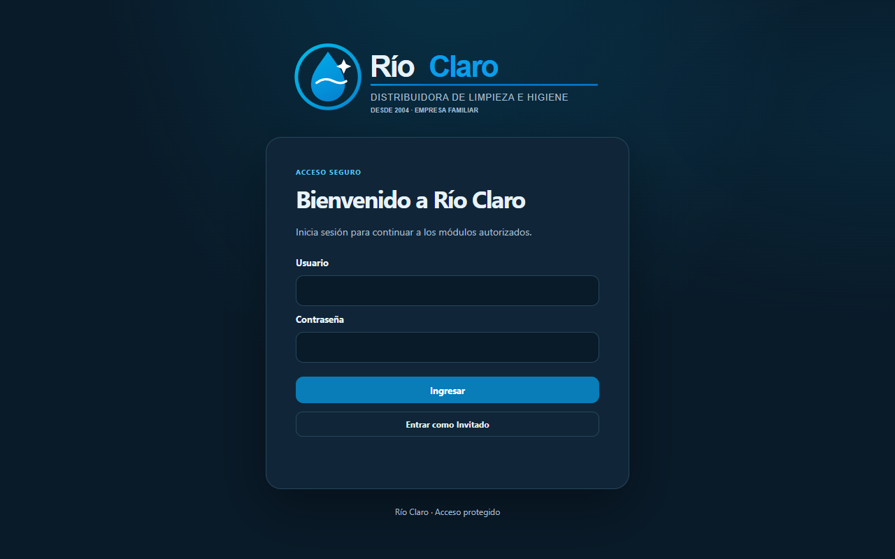
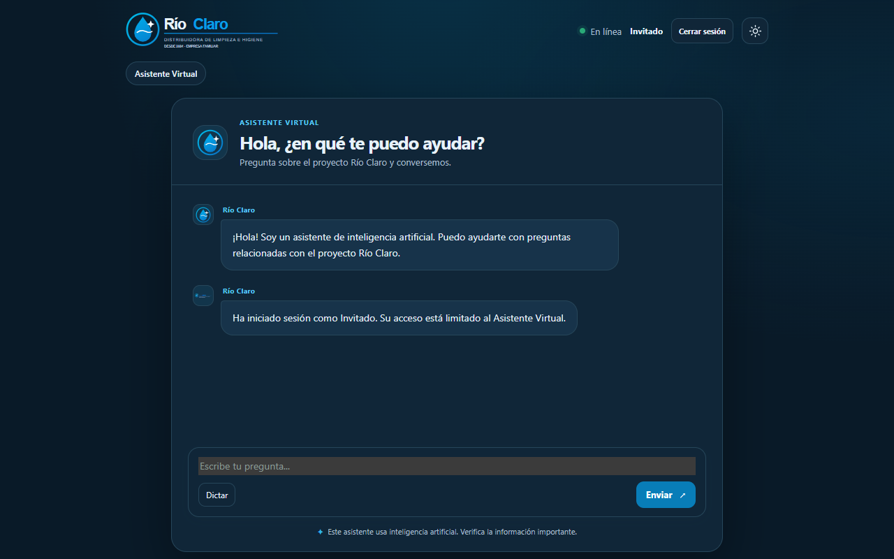
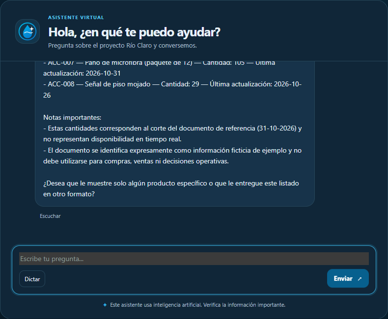
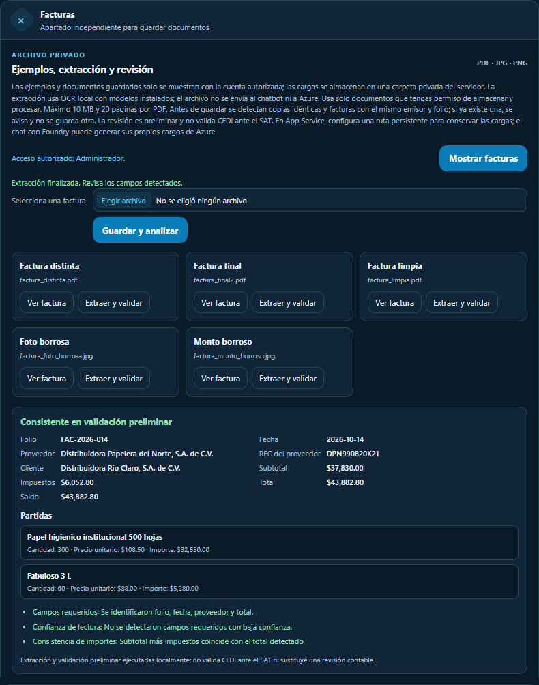
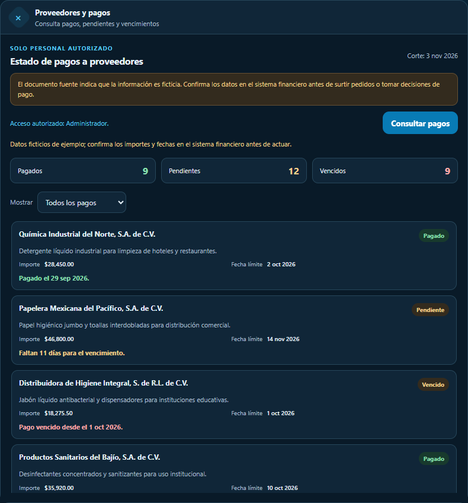
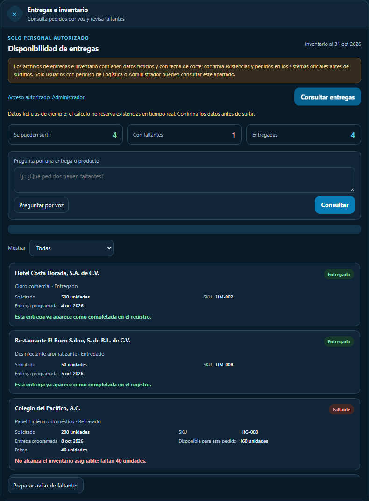
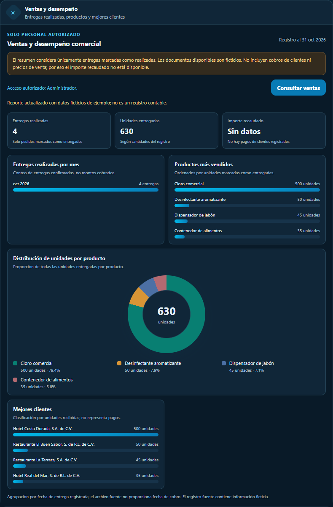
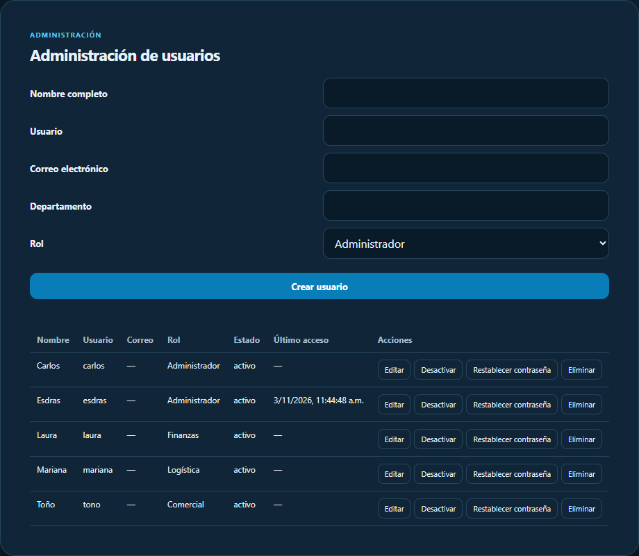
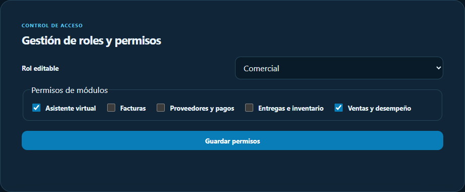
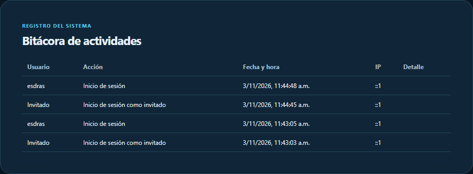

<p align="center">
  
</p>

<h1 align="center">💧 Río Claro – Asistente de IA y panel operativo</h1>

<p align="center">
  
  
  
  
  
</p>

Aplicación web (HTML, CSS y JavaScript vanilla) con un backend Node.js + Express 5 que conversa con un agente de **Microsoft Foundry**. Incluye autenticación por roles, gestión de facturas con OCR local y paneles de proveedores, entregas y ventas.

📚 Proyecto del curso *Fundamentos de IA con Tecnologías Microsoft*. Los documentos de `Documentos/` son **ficticios** y tienen fecha de corte; no representan existencias ni datos reales.


## ✨ Características

- 🤖 **Chatbot multi-turno**: el backend usa `openai.conversations.create()` y `openai.responses.create()` con una referencia al agente. El navegador nunca habla directo con Foundry.
- 🔐 **Autenticación y roles**: Administrador, Finanzas, Logística, Comercial e Invitado, con SQLite local (`node:sqlite`). Sesiones JWT en cookies `HttpOnly`, `SameSite=Strict` y `Secure` en producción; refresh token rotativo almacenado como hash; auditoría de cambios e inicios/cierres de sesión.
- 🧾 **Facturas**: carga de PDF/JPG/PNG (máx. 10 MB y 20 páginas por PDF), almacenamiento privado fuera de `public/`, detección de duplicados (SHA-256, RFC y folio → HTTP 409), vistas previas autenticadas y análisis bajo demanda con PDF.js y Tesseract.js (modelo en español local). No se envían a Azure ni a Foundry.
- 🏭 **Proveedores**: estados de pago calculados con `Documentos/Proveedores.md` y fecha de Ciudad de México.
- 🚚 **Entregas**: asignación por fecha programada con base en `Entregas.md` e `InventarioGeneral.md`, sin reservar existencias reales.
- 📊 **Ventas**: resumen de entregas realizadas por mes, producto y cliente, con gráfica circular.
- ✅ Permisos verificados en la interfaz y en cada endpoint.

### 👥 Usuarios y roles iniciales

Creados por `npm run setup-access` (las contraseñas son aleatorias, de un solo uso, y no se guardan en el repositorio):

| Usuario | Nombre | Rol |
|---|---|---|
| `esdras` | Esdras | 🛠️ Administrador Principal|
| `carlos` | Carlos | 🛠️ Administrador |
| `laura` | Laura | 💰 Finanzas |
| `mariana` | Mariana | 🚚 Logística |
| `tono` | Toño | 📈 Comercial |
| `invitado` | Invitado | 👤 Invitado (acceso temporal para nuevos clientes) |

| Rol | Acceso |
|---|---|
| 🛠️ Administrador | Acceso total: chatbot, facturas, proveedores, entregas, ventas, usuarios, roles, configuración y auditoría |
| 💰 Finanzas | Chatbot, facturas y proveedores |
| 🚚 Logística | Chatbot y entregas |
| 📈 Comercial | Chatbot y ventas |
| 👤 Invitado | Solo chatbot |

## 🌐 Prueba la aplicación

>🔗 **https://rio-proyect-esdras.azurewebsites.net**

| Usuario | Rol | Acceso para probar |
|---|---|---|
| `invitado` | 👤 Invitado | Botón de acceso como invitado, sin contraseña (solo chatbot) |
| `laura` | 💰 Finanzas | laura1234567 |
| `mariana` | 🚚 Logística | mariana1234567 |
| `tono` | 📈 Comercial | tono12345678 |
| `carlos` | 🛠️ Administrador | carlos1234567 |

> 🔒 En cuestion de algun cambio en las contraseñas por favor de notificarlo, para restablecer las contraseñas de prueba

## 🖼️ Capturas de pantalla

Capturadas con datos ficticios de ejemplo.

### 🔑 Inicio de sesión


### 👤 Invitado


### 🤖 Asistente virtual


### 🧾 Facturas


### 🏭 Proveedores y pagos


### 🚚 Entregas e inventario


### 📊 Ventas y desempeño


### 🛠️ Administración de usuarios


### 🔐 Roles y permisos


### 📜 Auditoría


## ⚖️ IA responsable: estado real del proyecto

Evaluación honesta, con base en el código actual. Es un proyecto de curso con datos ficticios; solo es la base para empezar a implementar en produccion con datos veridicos y sin parar el servicio.

| Principio | Pregunta en Río Claro | Respuesta (estado real) |
|---|---|---|
| ⚖️ Equidad | ¿El agente trata igual a clientes de todas las sucursales, o favorece a la que tenía más y mejores datos? | ⚠️ **No está medido.** El agente no distingue sucursales: no hay datos ni lógica por sucursal (solo una mención de «cinco sucursales» en `Proveedores.md`). Tampoco hay pruebas de sesgo; el agente responde con lo que contiene el inventario ficticio cargado en sus instrucciones. |
| 🛡️ Confiabilidad y seguridad | ¿Qué pasa si una factura está borrosa? ¿Se marca para revisión humana en lugar de inventar un total? | ✅ **Sí, en facturas.** Si faltan campos o la confianza de lectura (OCR) es menor a 0.8, el sistema marca «Requiere revisión manual» y no completa datos. Es una extracción preliminar que no certifica CFDI/SAT. ⚠️ En el chatbot, la instrucción «no inventes» reduce pero **no garantiza** que no haya errores. |
| 🔒 Privacidad y seguridad | ¿Nóminas, precios y datos de clientes quedan protegidos con Entra ID y Key Vault? ¿Se evita enviar datos sensibles innecesarios al modelo? | ⚠️ **Parcial.** ✅ Se usa identidad administrada / `DefaultAzureCredential` (Entra ID) para llamar a Foundry; no hay llaves en el código. ✅ Las facturas no se envían a Azure ni a Foundry (OCR local). ✅ Autenticación con roles, bcrypt, JWT en cookies `HttpOnly` y auditoría. ❌ **No se usa Key Vault**: los secretos (`AUTH_TOKEN_SECRET`) están en variables de entorno / app settings. ❌ No hay nóminas en el proyecto. Al modelo sí se envían el inventario ficticio (en las instrucciones del agente) y los mensajes del usuario; el sistema no los filtra. |
| ♿ Inclusión | ¿El asistente funciona por voz y desde el celular para el personal de bodega? | ⚠️ **Parcial.** ✅ Hay botón «Dictar» (reconocimiento de voz del navegador) en el chat y en entregas, y «Escuchar» para leer respuestas. ✅ Diseño con `viewport` y reglas responsivas (`@media`), y regiones `aria-live`. Depende del soporte del navegador (el dictado no funciona en todos) y **no se ha probado en dispositivos móviles reales**. No es una app móvil dedicada. |
| 🔎 Transparencia | ¿El usuario sabe que habla con una IA y de qué documento salió cada respuesta? | ⚠️ **Parcial.** ✅ Sí sabe que habla con una IA: el saludo dice «Soy un asistente de inteligencia artificial» y hay un aviso «Verifica la información importante». ❌ **No se muestra de qué documento salió cada respuesta**: el chatbot no cita fuentes. |
| 🧑‍⚖️ Rendición de cuentas | ¿Quién revisa y aprueba lo que sugiere la IA, por ejemplo antes de pagar una factura? | ⚠️ **Parcial.** ✅ La IA no paga ni ejecuta acciones: el análisis de facturas es local y solo informativo, y los avisos de faltantes se comparten de forma manual. ✅ Los cambios de usuarios, roles, contraseñas y sesiones quedan en auditoría. ❌ **No existe un flujo de aprobación** (no hay botón ni registro de quién aprobó una factura o sugerencia); la revisión humana depende del proceso externo de la empresa. |

### 🛠️ Mejoras pendientes sugeridas

- Guardar los secretos en Azure Key Vault.
- Citar el documento fuente en las respuestas del chatbot.
- Agregar un flujo de aprobación con registro en auditoría.
- Probar el dictado y la interfaz en celulares reales.
- Evaluar sesgos si se incorporan datos por sucursal.

## 📋 Requisitos

- Node.js 24 LTS y npm
- Un proyecto y agente en Microsoft Foundry (para el chatbot)
- Azure CLI con sesión iniciada (`az login`) para autenticación local con `DefaultAzureCredential`

## 🗂️ Estructura

```text
rio-proyect/
├── server.js              # Servidor Express y rutas
├── auth.js                # Sesiones JWT y validación de contraseñas
├── auth-store.js          # Roles, usuarios y SQLite
├── invoice-storage.js     # Almacenamiento privado de facturas
├── invoice-analysis.js    # OCR y validación de facturas
├── suppliers.js           # Lógica de proveedores y pagos
├── deliveries.js          # Lógica de entregas e inventario
├── sales.js               # Resumen de ventas
├── public/                # Frontend (HTML, CSS y JS vanilla)
│   ├── index.html
│   ├── app.js
│   ├── styles.css
│   └── logo*.svg
├── scripts/               # create-agent, setup-access y utilidades
├── Documentos/            # Datos ficticios y facturas de ejemplo
├── docs/screenshots/      # Capturas del README
├── test/                  # Pruebas con node:test
└── test-support/          # Utilidades de prueba
```

| Carpeta / archivo | Función |
|---|---|
| ⚙️ `server.js` | Punto de entrada del backend |
| 🔐 `auth*.js` | Autenticación y roles |
| 🧾 `invoice-*.js` | Facturas |
| 📦 `suppliers.js`, `deliveries.js`, `sales.js` | Lógica de los paneles |
| 🎨 `public/` | Interfaz web |
| 📜 `scripts/` | Creación del agente y accesos |
| 🧪 `test/`, `test-support/` | Pruebas automatizadas |

## ⚙️ Configuración

1. Instala dependencias:

   ```powershell
   npm install
   ```

2. Crea `.env` a partir de `.env.example` (no lo subas al repositorio):

   | Variable | Descripción |
   |---|---|
   | `FOUNDRY_PROJECT_ENDPOINT` | Endpoint del proyecto de Foundry |
   | `FOUNDRY_AGENT_NAME` | Nombre del agente |
   | `AUTH_TOKEN_SECRET` | Secreto de firma JWT (lo genera `setup-access`) |
   | `AUTH_DATABASE_PATH` | Opcional. Ruta de la base SQLite (por defecto `data/rio-claro.sqlite`) |
   | `INVOICE_STORAGE_DIRECTORY` | Ruta del almacenamiento privado de facturas |
   | `PORT` | Puerto (lo define App Service) |

3. Crea el agente con el inventario como contexto (opcional si ya existe):

   ```powershell
   npm run create-agent
   ```

4. Crea roles y cuentas iniciales:

   ```powershell
   npm run setup-access
   ```

   Genera contraseñas aleatorias de un solo uso (se exige cambiarlas en el primer acceso). `npm run reset-access` rota las credenciales.

## 🚀 Ejecución

```powershell
npm run dev      # desarrollo con recarga
npm start        # producción (node server.js)
npm test         # pruebas
```

Abre http://localhost:3000 y verifica la salud:

```powershell
Invoke-RestMethod http://localhost:3000/health   # status: ok
```

## 🔌 API principal

| Método | Ruta | Descripción |
|---|---|---|
| GET | `/health` | Estado del servicio |
| POST | `/api/auth/login`, `/api/auth/guest` | Inicio de sesión |
| POST | `/api/auth/refresh`, `/api/auth/logout` | Rotar / revocar sesión |
| POST | `/api/chat` | Mensaje al agente (1–2000 caracteres; 422 si es inválido, 502 si Foundry falla) |
| GET/POST | `/api/invoices`, `/api/invoices/:id/analyze` | Facturas (requiere permiso) |
| GET | `/api/suppliers`, `/api/deliveries`, `/api/sales` | Paneles (requieren permiso) |
| GET | `/api/admin/users`, `/roles`, `/audit` | Administración y auditoría |

## ☁️ Despliegue en Azure App Service (Linux, Node 24)

- Usa **identidad administrada** con rol *Foundry User* sobre el recurso; no uses API keys.
- Configura las variables de entorno como app settings.
- Coloca `AUTH_DATABASE_PATH` e `INVOICE_STORAGE_DIRECTORY` bajo `/home` y habilita el almacenamiento persistente.
- El script `start` es `node server.js`.
- El chatbot de Foundry y el App Service pueden generar cargos independientes.

## 🛡️ Seguridad

- No incluyas llaves, tokens, contraseñas ni endpoints reales en el código; `.env` y `data/` están en `.gitignore`.
- Los tokens nunca se guardan en `localStorage`.
- La extracción de facturas es preliminar: no certifica CFDI/SAT ni sustituye la revisión contable.
# rio-proyect
